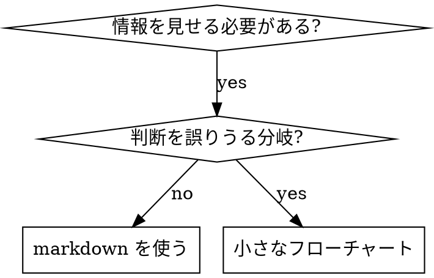

# writing-skills

## 概要

skill を書くことは、手順書に対するテスト駆動開発になる。

テストケース (subagent に解かせる圧力シナリオ) を書き、skill 無しで失敗するのを見て (baseline)、
skill を書き、skill ありで通るのを見て、抜け道を塞ぐ (refactor)。

**中心の原則:** skill 無しでエージェントが失敗するのを見ていないなら、その skill が正しいことを
教えているかは分からない。

**前提:** この skill は、テスト駆動開発の RED-GREEN-REFACTOR の周期を文書へ当てはめる。
各段は RED (落ちるテストを先に書いて落ちるのを見る)、GREEN (通す最小限を書く)、REFACTOR (通したまま整える) になる。

**公式の指針:** Anthropic の
[skill authoring best practices](https://platform.claude.com/docs/en/agents-and-tools/agent-skills/best-practices.md)
が validator の上限と progressive disclosure の判断を持つ。この skill に無い判断が要るときに読む。
着手前の予習としては読まない。Claude Code 専用の frontmatter と置換の仕組みは
[skills reference](https://code.claude.com/docs/en/skills.md) にあり、記憶に頼らずそこで確かめる。

## skill とは

skill は、実績のある技法・パターン・ツールの参照ガイドになる。後のエージェントが有効なやり方を
見つけて当てはめるために使う。

**skill であるもの:** 再利用できる技法、パターン、ツール、参照ガイド。

**skill でないもの:** ある問題を一度どう解いたかの物語。

**本文に入れないもの:**

- 計測結果と現状の報告。本文には手順、出力の読み方、閾値を置く。次に実行すると変わる行 (数値、日付、commit) は、skill から指す記録ファイルへ置く。
- 固定したツールのバージョンと、上流で直ったバグの回避策。例は最新を入れる形 (`aqua g -i <pkg>`) で書き、回避策が要らなくなったら理由ごと消す。リポジトリ自身の lockfile (`aqua.yaml`) はバージョンを固定してよい。
- 配布する skill が使うツールの導入手順 (aqua、`go install tool`、brew、CI の install step)。skill が実行するコマンドの名前だけを書く。マシンへの入れ方は利用者の環境の話で、user scope の skill が扱う。
- その回の固有名 (横展開の実例に出たツール名やバージョン)。固有名を外して一般化した 1 文にし、意味が残らないなら入れない。
- その skill が引かれない場面の手順。引かれる場面で効く規範だけを足す。

## skill を作るとき

**作る:**

- 自分にとって直感的に明らかでなかった技法
- プロジェクトをまたいで何度も参照するもの
- 広く当てはまるパターン (プロジェクト固有でない)
- 他の人も得をするもの

**作らない:**

- 一回限りの解決
- 他で十分に文書化された標準的なやり方
- プロジェクト固有の決めごと (指示ファイルへ書く)
- 機械的な制約 (正規表現や検証で強制できるなら自動化し、文書は判断の要るものに使う)

## skill の種類

| 種類 | 中身 | 例 |
|---|---|---|
| 技法 | 手順のある具体的な方法 | condition-based-waiting、root-cause-tracing |
| パターン | 問題の捉え方 | flatten-with-flags、test-invariants |
| 参照 | API の文書、構文ガイド、ツールの文書 | office docs |

## ディレクトリ構成

```text
skills/
  skill-name/
    SKILL.md              # 本体 (必須)
    supporting-file.*     # 要るときだけ
```

ディレクトリ名が `/command` になり、`name` フィールドは表示にだけ使う。
個人とプロジェクトの skill は名前空間を共有する。plugin の skill は `plugin:skill`、
入れ子のプロジェクト skill は `subdir:skill` になる。

**別ファイルに分けるもの:**

1. **重い参照** (100 行以上): API の文書、網羅的な構文。エージェントは先頭 100 行しか読まないことが多いので、冒頭に目次を置く。
2. **再利用するツール**: スクリプト、ユーティリティ、テンプレート。同梱スクリプトは相対パスでなく `CLAUDE_SKILL_DIR` の置換で指し、実行するのか読むのかを書く。

**本文に残すもの:** 原則と考え方、50 行未満のコードパターン、その他すべて。

supporting file は SKILL.md から 1 階層で直接リンクする。別の supporting file を経由してしか
たどれないファイルは、エージェントに読まれない。

**既存 skill へ新しい規範を足すとき:** 本文が既に長い skill では、足す前に置き場を決める。
`references/<topic>.md` を新設して規範本体をそこに書き、本文側は規範が効く条件の箇所に
1 行の pointer (「〜のときは references/<topic>.md を重ねて適用する」) だけ足す。本文を
肥大化させたまま育てない。独立サブスキル化まで踏み込むのは、発火面が既存 skill と完全に
異なるときだけにする。

## SKILL.md の構造

**frontmatter (YAML):**

- 持ち運べるフィールドは `name`、`description`、`license`、`compatibility` (500 文字以内)、`metadata`、`allowed-tools` の 6 つ。既定ではこれだけを使う。Claude Code の外 (claude.ai へのアップロード、Skills API、パッケージ化) では、ほかのキーがあると `Unexpected key(s) in SKILL.md frontmatter` で読み込みが失敗する。
- `name` はスラッシュコマンドの名前になる。Claude Code では省略でき、既定はディレクトリ名。それでも書き、ディレクトリ名と同じにする。Claude Code の外では必須で、小文字の英字・数字・ハイフンの 64 文字以内、XML タグと予約語 (`anthropic`、`claude`) を含めない。
- `description` は三人称で、引くきっかけだけを書く (「skill を見つけてもらう」節)。Claude Code の一覧では `description` と `when_to_use` をつないだ文字列が 1,536 文字で切られる (`skillListingMaxDescChars`)。Claude Code の外の上限は 1,024 文字。500 文字未満を目安にする。
- Claude Code 専用のフィールドは、本質的に Claude Code 専用の skill にだけ使う。`when_to_use`、`argument-hint`、`arguments`、`disable-model-invocation`、`user-invocable`、`disallowed-tools`、`model`、`effort`、`context`、`agent`、`background`、`hooks`、`paths`、`shell` がこれにあたる。型と既定値は使う前に skills reference で確かめる。
- Claude Code は知らないフィールドをエラー無しで無視する。綴りを誤ったフィールドや存在しないフィールドは、黙って何もしない。`claude plugin validate --strict` が skill で拾うのは frontmatter ブロックの欠落だけで、知らないフィールドも壊れた YAML も通す。frontmatter は自分の目で読み返す。

```markdown
---
name: skill-name-with-hyphens
description: <引くきっかけ>ときに使う。
---

# skill-name-with-hyphens

<何の skill かを 1〜2 文>
```

本文の並びと各節の文言は [writing-the-text.md](writing-the-text.md) に従う。

**本文中の `` !`command` `` による動的コンテキスト注入:** frontmatter の `context` フィールド
(`context: fork`、skill を subagent として fork する指定) とは別の機構。本文中の `` !`command` ``
は、内容が送られる前にコマンドを実行し、出力をその場に展開する。見出し名 (`## Context` など) は
慣習にすぎず予約されていない。実行は通常の Bash 権限ルールをそのまま通るため、複合コマンド
(`&&` `||` `;` `|` 改行) は subcommand ごとに allow/deny/ask へ照合される。skill の読み込み中は
プロンプトを出せないため、auto mode 以外では allow に一致しない subcommand がそのまま invocation
の中断になる。通るかどうかは構文の種類ではなく読み手の allow ルール次第なので、動的注入には
自分の allow ルールで確実に通る単一コマンドだけを置き、複合判定は本文のワークフロー側
(ツール呼び出し) に出す。

## skill を見つけてもらう

後のエージェントが skill を見つけられることが、何より先に要る。

### 1. description

**目的:** エージェントは description を読んで、その作業で読み込む skill を決める。
description は「今この skill を読むべきか」に答える。

**書くもの:** 主題と、引くきっかけ (どんな場面で使うか)。使わない場面や隣接 skill との責務境界、
一般語と紛らわしい固有名詞があれば、それも書く。日本語なら「〜ときに使う。」で結ぶ。

**書かないもの:** skill の手順 (段階、その順序、パスの回数)、具体的なコマンド名や症状の列挙、
references のファイル名や原典 URL。既存 skill に用途を 1 つ足したときも、description に
その用途の 1 句を足さない。本文の表や節で引ける。

**手順を書かない理由:** description が skill の手順を要約していると、エージェントは本文を読まずに
description のとおりに動くことがある。テストでは、description に「タスクの間にコードレビュー」と
書いた skill を使った。本文のフローチャートは 2 回のレビュー (仕様への適合、次にコード品質) を示している
のに、エージェントは 1 回だけレビューした。description を「独立したタスクを持つ実装計画を実行するとき」へ
削ると、エージェントはフローチャートを読んで 2 回とも行った。手順を要約した description は近道になり、
本文は読み飛ばされる文書になる。

**列挙を書かない理由:** description は全 skill ぶんが毎セッション読み込まれ、長い description は
他の skill の description を一覧から押し出す (「文脈のコスト」)。コマンド名と症状は本文に置けば、
読み込まれた後に効く。

Anthropic のガイドは「何をするか、いつ使うか」を、押しの強い書き方で求めている (Claude が引き損ねやすい
ため)。この skill はそれより狭い規則を取る。押しの強さは引くきっかけの書き方で出し、
手順の要約は入れない。手順の要約が逆効果になることは計測で分かっている。

**中身:**

- 問題の性質 (競合状態、挙動が一定しない) を書く。言語固有の症状 (`setTimeout`、`sleep`) は書かない
- skill 自体が特定の技術に依る場合だけ、その技術名を引くきっかけに含める
- 三人称で書く (system prompt に注入される)

```yaml
# ❌ 手順を要約している。エージェントが本文を読まずにこれに従う
description: 計画を実行するときに使う。タスクごとに subagent を起こし、タスクの間にコードレビューする。

# ❌ 抽象的すぎて、いつ使うかが無い
description: 非同期テスト向け

# ❌ 一人称
description: テストが不安定なとき、私が非同期テストを手伝えます

# ❌ skill が特定の技術に依らないのに技術名を出している
description: テストが setTimeout や sleep を使っていて不安定なときに使う。

# ❌ 症状とコマンド名を列挙している
description: テストが不安定なときに使う。ENOTEMPTY、Hook timed out、jest --runInBand、afterEach の後始末漏れも扱う。

# ✅ 引くきっかけだけで、手順の要約が無い
description: 独立したタスクを持つ実装計画を、今のセッションで実行するときに使う。

# ✅ 問題を書き、手順が無い
description: テストに競合状態やタイミング依存があるとき、成否が実行ごとに変わるときに使う。

# ✅ 特定の技術に依る skill で、そのことを引くきっかけに書いている
description: React Router で認証のリダイレクトを扱うときに使う。
```

### 2. 本文の語彙

description に書かない語は、本文で引けるようにする。エージェントが探す語を本文に入れる。

- エラーメッセージ: 「Hook timed out」「ENOTEMPTY」「race condition」
- 症状: 「不安定」「固まる」「ゾンビ」「汚染」
- 同義語: 「timeout / hang / freeze」「cleanup / teardown / afterEach」
- ツール: 実際のコマンド、ライブラリ名、ファイルの種類

### 3. 名前

**すること、または核心の洞察で名付ける。能動態で、動詞を先に置く:**

- `creating-skills` (`skill-creation` でなく)
- `condition-based-waiting` (`async-test-helpers` でなく)
- `flatten-with-flags` (`data-structure-refactoring` でなく)
- `root-cause-tracing` (`debugging-techniques` でなく)

過程を表すなら動名詞 (-ing) が合う: `creating-skills`、`testing-skills`、`debugging-with-logs`。

### 4. 文脈のコスト

skill の token は次の時点で払う。

- **description: 毎セッション。** 全 skill の名前と description が skill の一覧に読み込まれ、上限は context window の 1% (`skillListingBudgetFraction`)。上限を超えると、Claude Code は名前をすべて残し、使われていない skill から順に description を落とす。膨らんだ description 1 つが、他の skill の引くきっかけを奪う。
- **本文: 呼び出したとき。** 500 行未満に収める。`/compact` の後に付け直された skill は先頭 5,000 token だけが残り、付け直された他の skill と合わせて 25,000 token を分け合う。エージェントが失ってはいけないことは先頭に置く。
- **supporting file: 必要になったとき。** 読まれるまでは無料。

**削り方:**

- フラグを全部書かず `--help` を指す
- 他の skill の手順を繰り返さず、skill 名で参照する
- パターン 1 つにつき、圧縮した例 1 つ
- コマンドを見れば分かることは説明しない

### 5. 他の skill を参照する

skill 名だけを書き、必須かどうかを明示する。plugin の skill は `<plugin>:<skill>` で書く。
節名は書かない (改名で切れる)。

次のように書く。

- `**必須の下位 skill:** my-plugin:test-first を使う`
- `**前提:** my-plugin:root-cause-debugging を理解していること`

次の書き方は避ける。

- `skills/testing/test-driven-development を参照` (必須かどうかが分からない)
- `my-plugin:test-first の「RED の書き方」節を参照` (節名は改名で切れる)
- `@skills/testing/test-driven-development/SKILL.md` (要る前にファイルを context へ読み込ませる)

## フローチャート



**フローチャートを使うのは次だけ:**

- 明らかでない判断の分岐
- 早く止めすぎるおそれのある繰り返し
- 「A と B のどちらを使うか」の判断

**フローチャートにしないもの:**

- 参照資料 → 表、箇条書き
- コード例 → markdown のコードブロック
- 一直線の手順 → 番号付きの箇条書き
- 意味を持たないラベル (step1、helper2)

graphviz の書式は [graphviz-conventions.dot](graphviz-conventions.dot) が持つ。

**フローチャートを図で確かめるとき:** 同梱の `render-graphs.js` で skill のフローチャートを
SVG ファイルに書き出す。node と graphviz (`dot`) が要る。

```bash
node "${CLAUDE_SKILL_DIR}/render-graphs.js" <skill のディレクトリ>
node "${CLAUDE_SKILL_DIR}/render-graphs.js" <skill のディレクトリ> --combine
```

`render-graphs.js` は、対象の skill のディレクトリの `diagrams/` へ SVG を書き出す。
`--combine` を付けると全部の図を 1 枚の SVG にまとめ、付けなければ図ごとに出す。

## コード例

**優れた例 1 つは、凡庸な例いくつにも勝る。**

言語は内容に合うものを選ぶ。

- テストの技法 → TypeScript / JavaScript
- システムのデバッグ → Shell / Python
- データ処理 → Python

**よい例:**

- そのまま動く
- 実際の場面から取っている
- パターンがはっきり見える
- 手直しして使える (汎用のテンプレートではない)

なぜそう書くかは例の外の本文に書き、例そのものにはコメントを入れない。キーや要素の並びに意味が無いなら
辞書順にする (`needs` の並び、YAML のキー)。

**しないこと:**

- 5 つ以上の言語で実装する
- 穴埋め式のテンプレートを作る
- 作為的な例を書く

エージェントは移植が得意なので、優れた例 1 つで足りる。

## 配布する前にテストする

先に失敗するテストを見ずに配布する skill は無い。新しい skill も、既存 skill の修正も同じ。
落ちるのを見ていないテストが何を確かめているか分からないのと同じく、エージェントが失敗するのを見ずに書いた skill は、
エージェントが実際に何を誤るかの推測でしかない。

シナリオはどれも新しい context (subagent か `claude -p`) で走らせる。skill を書いたときの context が
残っていると、書いた指示の穴が隠れる。

**ツール:**

- `claude plugin eval`: RED の baseline を CLI で取る。`--ablation with-without` で各ケースを skill ありと無しで走らせ、差を出す。差がほぼ 0 で `tool_used: Skill` の grader が落ちるなら、description が自然な言い回しで引かれていない。`claude plugin eval init` が `evals/` に suite の雛形を作る。対象は plugin で、`claude plugin init` で作った `~/.claude/skills/<name>/` も含む。
- `/skill-doctor`: skill ごとの文脈のコストと呼び出し回数を出し、一度も引かれていない skill を示す。

テストの仕方は skill の種類で変わる。

| skill の種類 | テストの仕方 | 成功の基準 |
|---|---|---|
| **規律を課す** (テスト駆動開発、完了前の検証) | 知識を問う質問と、圧力シナリオ (時間、サンクコスト、権威、疲労、その組み合わせ) | 最大の圧力の下でも規則に従う |
| **技法** (原因を順に絞るデバッグ) | 適用のシナリオ、変化を加えたもの、情報が欠けたもの | 新しい場面に技法を当てはめる |
| **パターン** (考え方のモデル) | 見分けるシナリオ、適用のシナリオ、反例 | いつ・どう当てはめるか、いつ当てはめないかを見分ける |
| **参照** (API、コマンドのガイド) | 引き出すシナリオ、適用のシナリオ、抜けのテスト | 正しい情報を見つけて正しく使う |

## 失敗の型に合わせて書き方を選ぶ

指針を書く前に、baseline の失敗を分類する。ある失敗の型を塞ぐ書き方は、別の型では逆効果になることが
計測で分かっている。

| baseline の失敗 | 合う書き方 | 合わない書き方 |
|---|---|---|
| 圧力の下で規則を飛ばす・破る (分かっていてやる) | 禁止 + 言い訳の表 + 危険信号 (「言い訳に負けない skill にする」節) | 柔らかい指針 (「〜が望ましい」「〜を検討する」) |
| 従っているが出力の形が違う (膨らんだ prompt、埋もれた結論、仕様の言い直し) | 前向きのレシピか契約。出力が何であるか (部品とその順序) を書く | 禁止の列挙 (「言い直さない」「経過を語らない」) |
| 作っているものから必須の要素が抜ける | 構造で塞ぐ。埋めるテンプレートに必須のフィールドや枠を置く | テンプレートの近くに置いた文章の注意書き |
| 条件によって振る舞いを変えたい | 観察できる述語で分岐する条件 (「brief があるなら、それを参照する」) | 無条件の規則 + 例外の但し書き |

**形の問題に禁止が逆効果になる理由:** 競合する動機 (「prompt を自己完結させる」) があると、
エージェントは「X しない」と交渉する。dispatch prompt の指針を文言だけ変えて比べたテストでは、
禁止の側がレシピの側よりはっきり多く不要な中身を出した (両者の分布は重ならなかった)。指針の無い対照群
より悪い傾向さえ出た。自分の場面は小さく試して確かめる。そのうえで、既定では禁止に手を伸ばさない。
レシピには交渉の余地が無い。出力は示した形に合うか、合わないかのどちらかになる。

**どの書き方を選んでも守ること:**

- **含みを持たせる但し書きを付けない。** 「重要なとき以外は X しない」は交渉を再開させる。同じ文言比較のテストで、勝ったレシピに含みの但し書きを 1 つ足しただけで、安定した結果がばらつくようになった。本当の例外は、観察できる述語で分岐する独立した条件として書く。
- **例外の但し書きは範囲を区切れない。** 「この上限はコードブロックには当てはまらない」と書いても、コードブロックは減る。出力の一部を除外したいなら、規則がそこへ届かない構造に組み替える。

## 言い訳に負けない skill にする

規律を課す skill (TDD など) は、言い訳に耐える必要がある。エージェントは賢く、圧力の下では抜け道を探す。

**範囲:** この道具立ては規律の失敗、つまり規則を知っていて圧力の下で飛ばす失敗のためにある。
出力の形が違う失敗や要素が抜ける失敗に禁止で塞ぐやり方を当てると、逆効果になる。そちらは
「失敗の型に合わせて書き方を選ぶ」節の書き方を使う。

**心理の補足:** [persuasion-principles.md](persuasion-principles.md) (Cialdini, 2021; Meincke et al., 2025)
は、圧力シナリオが効く理由を説明する。テストシナリオを組むのに使う。そこにある仕掛け (「必ず〜しなければ
ならない」、使用の宣言の義務付け、「例外なし」) は skill の本文に入れない。今のモデルは平易な文で 1 度書いた
規則に従い、叫んだ規則は効きすぎる。

### 抜け道をひとつずつ塞ぐ

規則を書くだけでなく、具体的な回避策を禁じる。

<Bad>

```markdown
テストより先にコードを書いた? 消す。
```

</Bad>

<Good>

```markdown
テストより先にコードを書いた? 消す。最初からやり直す。

**例外なし:**
- 「参考として」残さない
- テストを書きながら「流用」しない
- 見ない
- 消すとは消すこと
```

</Good>

### 「精神か字面か」の議論を断つ

基本の原則を早めに置く。

```markdown
**規則の字面を破ることは、規則の精神を破ることになる。**
```

これで「精神には従っている」という類の言い訳がまとめて断たれる。

### 言い訳の表を作る

baseline のテストで出た言い訳をそのまま書き写し、それぞれが成り立たない理由と対にする。

```markdown
| 言い訳 | 実際 |
|--------|---------|
| 「単純すぎてテストは要らない」 | 単純なコードも壊れる。テストは 30 秒で書ける。 |
| 「後でテストする」 | すぐ通るテストは何も証明しない。 |
```

表の大きさは対象のモデルに合わせる。能力の高いモデルには理由を 1 度書けば足りる。12 行の反論の壁は
呼び出すたびに token を食い、最初の数行より先は何も買わない。

### 違反の兆しを description に書く

規則を破りそうになる場面を、引くきっかけとして description に書く。

```yaml
description: 機能やバグ修正を実装するとき、実装コードを書く前に使う。
```

## skill の RED-GREEN-REFACTOR

TDD の周期に従う。

### RED: 失敗するテストを書く (baseline)

skill 無しで subagent に圧力シナリオを解かせ、振る舞いをそのまま記録する。

- どの選択をしたか
- どんな言い訳を使ったか (原文のまま)
- どの圧力で違反したか

これが「テストが落ちるのを見る」段階になる。skill を書く前に、エージェントが素のままで何をするかを見る。

### GREEN: 最小限の skill を書く

記録した言い訳に対処する skill を書く。仮定の場面のための中身は足さない。

同じシナリオを skill ありで走らせ、エージェントが従うことを見る。

### REFACTOR: 抜け道を塞ぐ

エージェントが新しい言い訳を見つけたら、それへの反論を明示して足す。崩れなくなるまでテストし直す。

### シナリオの前に文言を小さく試す

圧力シナリオを完全に走らせるのは配布前の最後の確認だが、1 回ごとに遅く高くつく。先に文言そのものを
小さなテストで確かめる。

1. **呼び出し 1 回につき、新しい context のサンプル 1 つ。** API を直接呼ぶか、API が使えなければ 1 回で終わる subagent を使う。system prompt はその指針が実際に置かれる context (指針だけでなく、skill 全体か prompt のテンプレート全体)、user message は失敗を誘うタスクにする。
2. **指針の無い対照群を必ず置く。** 対照群がその失敗を出さないなら、直すものは無い。そこで止め、指針を書かない。
3. **1 つの案につき 5 回以上。** 1 回のサンプルは嘘をつく。
4. **該当とされた箇所はすべて自分で読む。** 採点を機械で行ってもよいが、テンプレートの写しや引用した反例が該当に紛れる。機械の件数だけでは、失敗も成功も多めに出る。
5. **ばらつきも指標になる。** 指針が効くと、繰り返した結果が同じ形に収束する。5 回で 5 通りの解釈が出るなら、文言が縛れていない。語を足す前に書き方を締める。

小さなテストは文言を確かめるもので、規律の skill の圧力シナリオの代わりにはならない。

**テストの方法論:** 圧力シナリオの書き方、圧力の種類 (時間、サンクコスト、権威、疲労)、穴の塞ぎ方、
メタテストは [testing-skills-with-subagents.md](testing-skills-with-subagents.md) が持つ。

通しの実例は [examples/CLAUDE_MD_TESTING.md](examples/CLAUDE_MD_TESTING.md) にある。

## チェックリスト

項目ごとに todo を作る。

**RED:** 圧力シナリオを書き (規律の skill なら 3 つ以上の圧力を組み合わせる)、skill 無しで走らせ、
baseline の言い訳を原文のまま記録する。

**GREEN:** その失敗に対して skill を書く。

- [ ] frontmatter は持ち運べるフィールドを使い、`name` は小文字の英字・数字・ハイフンで 64 文字以内、ディレクトリ名と同じ
- [ ] description は三人称で、主題と引くきっかけだけを書き、手順の要約・コマンド名や症状の列挙が無く、1024 文字未満
- [ ] frontmatter を目で読み返し、どのフィールドも Claude Code が知っているものになっている (知らないフィールドを拾うツールは無い)
- [ ] 本文は 500 行未満で、supporting file は 1 階層でリンクしている
- [ ] 本文の並びと各節の中身が writing-the-text.md に沿っている
- [ ] エラー・症状・ツール名など、探される語が本文にある
- [ ] 指針の書き方が失敗の型に合っている
- [ ] 振る舞いを形づくる文言を、指針の無い対照群と比べて小さく試した
- [ ] 優れた例が 1 つで、言語ごとに並べていない
- [ ] フローチャートは判断が本当に明らかでない箇所だけ
- [ ] supporting file は再利用するツールか重い参照だけ
- [ ] skill ありでシナリオを走らせ直し、エージェントが従った

**REFACTOR:** テストで見つかった抜け道を塞ぎ、テストし直す。

1 つの skill を仕上げてから次へ進む。まとめて作ると、テストしていない skill を配ることになる。
