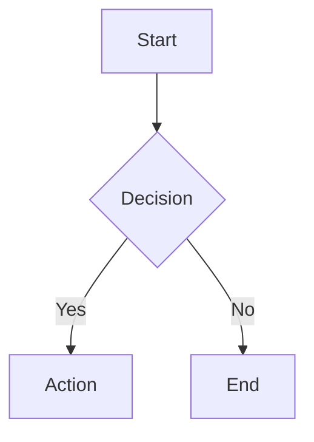

# mermaid-cli

Mermaid 記法のダイアグラムを書くときの規範と、mmdc (Mermaid CLI) による画像変換。

## Context

- Working directory: !`pwd`

## 記述規範 (レンダリング失敗を避ける)

以下を守れば parse error は出ない。ここに挙がっていない通常の文字 (`/` `+` `.` `'` `"` `:` `=` `::`、quoted rectangle label / subgraph title / sequence message 内の丸カッコ) は普通に使ってよい。

### ラベルの改行

- **改行に `<br/>` を使わず single-line label で書く**。多行にしたいときは `A: B` (名前と説明) か `A / B` (並列) の separator 形式にする

これだけは parse error にならず、**エラーを出さないままラベルが壊れる**。
mermaid v10 以降の `securityLevel` / `htmlLabels` 設定によっては `<br/>` が strip され、`A<br/>B` が `AB` に連結される。
たとえば `VirtualService<br/>sample-app-api` は `VirtualServicesample-app-api` になる。
書いた環境で見えていても、別のレンダラで壊れる。

### 丸カッコ

- **cylinder `[("...")]` と stadium `(["..."])` のラベル内に丸カッコ `(` `)` を入れない**: 終端パターン (`)]` / `"])`) を greedy に閉じる。`Apps(["Application (Explorer / Agent)"])` は NG → `Apps(["Application - Explorer / Agent"])`
- **flowchart edge label `|...|` 内に丸カッコ `(` `)` を入れない**: edge label は quote できず、`(` が `PS` トークンとして消費される。`A -->|routing (VirtualService)| B` は NG → `A -->|routing via VirtualService| B`

### 記号

- **flowchart node label に裸の `<word>` を使わない**: HTML タグ扱いで strip される。`&lt;word&gt;` と HTML entity で書く
- **flowchart edge label / node ID の先頭に `@<word>` を置かない**: mermaid v11 以降 `@` は edge ID 記法 (`e1@-->`)。`@reboot` 等は `@` を外すか別表記にする
- **stateDiagram-v2 の note description の先頭に `:` を置かない**: parser が `DESCR` トークンとして消費する。`: undeploy 不可` → `undeploy 不可`

### レイアウト制約 (dagre)

Mermaid の既定レンダラは dagre。ELK への切替はレンダリング側の設定変更が要るので、図の書き方で回避するほうが早い。

- **nested subgraph の `direction TB` は、inner node が subgraph 境界をまたぐ edge を持つと無視され、親の方向を継承する** ([Mermaid 公式](https://mermaid.ai/open-source/syntax/flowchart.html))。回避策: (a) edge を subgraph ID 起点に置換、(b) 構造を flat 化、(c) 親 `flowchart` を `TB` にする、(d) invisible edge `~~~` で sibling を pin (効かないことも多い)

### 確認

判断に迷う記法は、下の画像変換で実際に mmdc を通すのが確実。parse error なら mmdc がその場で落ちる。
`<br/>` 系のようにエラーを出さずに文字が欠ける問題も、出力画像を見れば気づける。

## シーケンス図の粒度

`sequenceDiagram` は collaborator 間の相互作用を主軸にする。Service 内部の validate / parse / transform を self-call (`Svc->>Svc:`) で一つずつ並べない。内部処理ステップを 5〜10 個並べると図がスクロールしないと読めなくなり、本来見せたい「どの境界をまたいで何が起きるか」が埋もれる。設計議論で必要なのは collaborator 間の責務分担とラウンドトリップ構造であって、method 名の列挙ではない。

- **まず依頼文の主語を読む**。「A と B のシーケンス」と言われたら participant は A + B の 2 つで描き始め、内部分割 (Controller / Service / Repository 等) は note に圧縮する。最初から詰め込むと差し戻される
- 参加者の目安: cross-service の責務分担を見せたいなら 2〜3、内部協調を見せたい設計議論なら 4〜6。8 を超えたら目的が複数混ざっているサイン
- 同一プロセス内のヘルパクラスや validator は participant にしない。`Note over X: 構文 / 存在 / 整合 / 重複を順次確認` のように束ねる
- Repository への複数 method 呼び出しは 1 メッセージにまとめる
- 外部システムへの副作用 (DDL 実行 / message publish / 外部 API) は note でもよい。ただし副作用の有無・非同期化・リトライが論点なら participant に上げる
- 実装ステップを詳細に追う必要があるときは、シーケンス図ではなく flowchart か箇条書きの処理フローで別に書く。図と本文で粒度を分けるのが基本構成

複雑でネストの深い構成図をこの skill で再現しようとすると dagre のレイアウトが崩れる。元図 (Miro 等) が既にあるなら、再現より原本の画像を埋め込んで出典リンクを添えるほうが正確で保守も楽。

## 棚卸し・整理文書の要約図

棚卸し・整理の文書で要約の図を描くときは、既存の棚卸しの中身を数える列挙ではなく、読み手が次にどこへ手を付けるかを示す図にする。

- 件数を並べない。件数は「いくつあるか」は伝えるが「どこから手を付けるか」は伝えない
- 課題はツリー構造 (テーマ → 束 → 個別) で描き、個別の課題がどう束ねられているかを見せる
- ノードの塗り分けは、その棚卸しで既に付けている優先度 (重要度) をそのまま使う。図のために新しい尺度を作らない

## 基本ワークフロー

### Step 1: Mermaid ファイルの作成

`.mmd` 拡張子で Mermaid 記法のファイルを作成する。



### Step 2: 画像変換

#### PNG (Confluence 添付・ドキュメント用、推奨)

```bash
mmdc -i input.mmd -o output.png -c ~/.claude/skills/mermaid-cli/config.json -s 2 -w 1200 -b white
```

- `-s 2`: スケール2倍 (高解像度)
- `-w 1200`: 幅1200px
- `-b white`: 白背景 (透過にしたい場合は `transparent`)

#### SVG

```bash
mmdc -i input.mmd -o output.svg -c ~/.claude/skills/mermaid-cli/config.json
```

> **PDF が必要な場合**: mmdc の PDF 出力はヘッドレス Chrome に依存して重いため使わない。
> 軽量な `typst-infographic` スキル (Typst, ブラウザ不要) を使う。
> Mermaid 図を PDF に含めたいときは、一旦 SVG/PNG にしてから Typst の `image()` で読み込む。

### Step 3: 出力確認

```bash
ls -la output.png
file output.png
```

画像が正常に生成されたことを確認する。

## テーマ選択

| テーマ | 用途 |
|--------|------|
| `default` | 一般的な用途 (デフォルト) |
| `dark` | ダークモード向け |
| `forest` | グリーン系カラースキーム |
| `neutral` | モノクロ・印刷向け |

```bash
mmdc -i input.mmd -o output.png -c ~/.claude/skills/mermaid-cli/config.json -t neutral -s 2 -w 1200 -b white
```

## 日本語フォント設定

スキルディレクトリに同梱の `config.json` で日本語フォント (Cica) を指定している。
全コマンド例に `-c ~/.claude/skills/mermaid-cli/config.json` が組み込み済み。

- **フォント変更**: `~/.claude/skills/mermaid-cli/config.json` の `fontFamily` を編集する
- **Cica インストール**: `brew install --cask font-cica`
- **インストール確認**: `fc-list | grep -i cica`

## 一時ファイル管理

Confluence 添付など一時的な画像生成では、`./tmp` 配下を使用する。

```bash
mkdir -p ./tmp
mmdc -i diagram.mmd -o ./tmp/diagram.png -c ~/.claude/skills/mermaid-cli/config.json -s 2 -w 1200 -b white
# 使用後
cc-rm tmp ./tmp/diagram.png
```

## トラブルシューティング

- **mmdc が見つからない**: `brew install mermaid-cli` でインストール
- **Puppeteer エラー**: `npx puppeteer browsers install chrome` でブラウザ再インストール
- **日本語文字化け**: 「日本語フォント設定」セクションを参照

## 詳細オプション

references/mmdc-options.md を参照。
